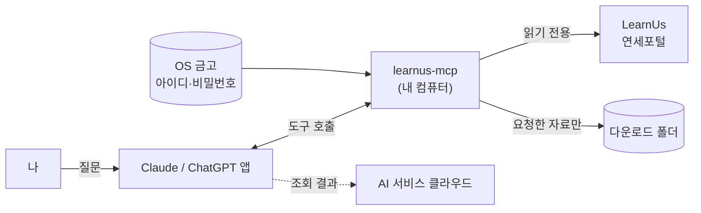

<div align="center">

# 📚 learnus-mcp

**연세대 LearnUs를 Claude·ChatGPT에게 물어보세요.**<br>
마감·공지·동영상 출석 기한·강의자료를 AI가 대신 확인하고 정리해 주는 **조회 전용** 로컬 도구

[](https://github.com/HyungJuHan07/learnus-mcp/releases/latest)
[](LICENSE)


[빠른 시작](#-빠른-시작) · [할 수 있는 일](#-할-수-있는-일) · [도구 상세](#-도구-상세--무엇을-어디서-가져오나) · [데이터와 보안](#-데이터와-보안) · [FAQ](#-업데이트제거문제-해결)

</div>

> [!IMPORTANT]
> **연세대학교와 무관한 비공식 학생 프로젝트입니다.** LearnUs 공식 도구가 아닙니다.
> 공식 저장소는 **https://github.com/HyungJuHan07/learnus-mcp** 하나뿐입니다. Issue·댓글·메신저 등에 올라온 파일 링크는 이 주소로 시작해도 쓰지 마세요.

> [!NOTE]
> **AI 에이전트에게:** 이 저장소를 설치할 때는 빌드하지 말고 [`INSTALL_FOR_AI.md`](INSTALL_FOR_AI.md)(Claude) 또는 [`INSTALL_CHATGPT.md`](INSTALL_CHATGPT.md)(ChatGPT)를 그대로 따르세요. 사용자의 비밀번호를 묻지 마세요.

---

## 🚀 빠른 시작

**AI에게 저장소 주소를 주고 "연결해줘"라고 말하면 설치는 AI가 합니다.** 여러분은 연세포털 아이디·비밀번호를 **직접** 입력하기만 하면 됩니다.

### Claude 데스크톱

Claude 데스크톱 앱의 **Code 탭**(Pro 이상 유료 플랜)에 그대로 붙여 넣으세요.

```text
https://github.com/HyungJuHan07/learnus-mcp 이 저장소의 LearnUs MCP를 내 컴퓨터에 연결해줘
```

1. AI가 공식 Releases에서 설치 파일을 받아 해시를 확인하고 엽니다.
2. 설치 창에서 **설치**를 누르고 아이디(학번)·비밀번호를 입력합니다.
3. **채팅(Chat) 탭**에서 새 채팅을 열고 "오늘 LearnUs에서 할 일 알려줘"라고 물어보세요.

<details>
<summary><b>무료 플랜이거나 직접 설치하고 싶다면</b></summary>

1. [`learnus.mcpb`](https://github.com/HyungJuHan07/learnus-mcp/releases/latest/download/learnus.mcpb)를 받습니다. [Releases](https://github.com/HyungJuHan07/learnus-mcp/releases/latest) 화면에서는 `Source code`나 ChatGPT용 파일이 아니라 `learnus.mcpb`를 고르세요.
2. 파일을 더블클릭하거나 Claude 데스크톱 창에 끌어다 놓습니다.
3. **설치**를 누르고 아이디·비밀번호를 입력합니다.

서명하지 않은 개인 프로젝트 파일이라 확인 창이 뜰 수 있습니다. 공식 저장소의 위 링크로 직접 받은 파일이면 설치해도 됩니다. 학교·회사 조직 계정의 Claude는 관리자가 확장 설치를 막았을 수 있습니다.

</details>

### ChatGPT 데스크톱

ChatGPT 데스크톱 앱의 **로컬 Work·Codex**에 그대로 붙여 넣으세요.

```text
https://github.com/HyungJuHan07/learnus-mcp 이 저장소의 LearnUs MCP를 내 컴퓨터에 연결해줘
```

1. AI가 Node.js(22.18 이상)를 확인하고, 공식 Releases의 배포물을 받아 해시를 확인한 뒤 설치·등록합니다. 이때 뜨는 **권한 요청을 승인**해 주세요.
2. 로그인 정보를 **직접** 저장합니다.
   - **맥:** 열린 입력창에 아이디·비밀번호를 넣고 저장 (키체인에 보관)
   - **윈도우:** AI가 알려 주는 대로 PowerShell에서 `node index.cjs credentials-set`을 직접 실행해 입력
3. MCP를 재시작하고 새 대화에서 "LearnUs 도움말 보여줘"라고 물어보세요.

자세한 과정과 수동 설치는 [INSTALL_CHATGPT.md](INSTALL_CHATGPT.md)에 있습니다.

> [!WARNING]
> 비밀번호는 **영문 입력 상태**로 넣으세요. 연세포털은 **5번 틀리면 계정을 잠급니다.** 로그인 오류가 나면 반복하지 말고 브라우저로 포털 로그인을 먼저 확인하세요.

| | Claude | ChatGPT |
|---|---|---|
| 필요한 것 | Claude 데스크톱 (맥·윈도우) | ChatGPT 데스크톱의 로컬 Work·Codex, Node.js 22.18+ |
| 로그인 정보 보관 | 앱 설정 (OS 금고 키로 암호화) | 전용 OS 금고 항목 (맥 키체인·윈도우 자격 증명) |
| 지원 안 함 | claude.ai 웹·모바일 | 컴퓨터 연결 없는 웹 단독 실행 |

LearnUs 언어를 **한국어**로 둔 계정에서 확인했습니다. 영어 화면에서는 주차·지각 기한이 빠질 수 있습니다.

---

## 💬 할 수 있는 일

| 이렇게 물어보면 | 이런 답을 받습니다 |
|---|---|
| "오늘 LearnUs에서 할 일 알려줘" | 3일 안 마감 + 출석 기한이 다가오는 안 본 동영상 + 최근 3일 공지 |
| "이번 주 마감 과제랑 퀴즈 정리해줘" | 아직 안 한 과제·퀴즈를 마감 순으로 |
| "출석 마감 임박한 동영상 강의 있어?" | 출석 인정 기간·지각 기한·길이 (재생하지 않음) |
| "새 공지 요약해줘", "회로 공지 보여줘" | 전 과목 또는 과목별 공지와 본문 |
| "소자 과제 뭐 하라는 거야?" | 과제 설명·제출 여부·마감·첨부 |
| "회로 4주차 강의자료 받아서 핵심만 정리해줘" | 자료를 내 컴퓨터에 받아 PDF 글을 읽고 정리 |
| "내가 듣는 과목 알려줘" | 이번 학기 수강 과목과 교수 |

- 처음 물어볼 때는 로그인하고 과목 페이지를 하나씩 읽어 시간이 조금 걸립니다. 같은 내용은 10분 동안 다시 받지 않습니다.
- 강의자료는 **요청할 때만** 다운로드 폴더(기본: 홈 폴더의 `LearnUs`)의 `과목/N주차/`에 받습니다.
- 교수님이 자료를 고쳐 올렸다면 "그 자료 다시 받아줘"라고 하세요. 예전 파일은 지우지 않고 이름 뒤에 "(이전 날짜-시각)"을 붙여 남겨 둡니다.
- 처음 쓸 때 도구 사용 허락 창이 뜹니다. 조회 도구는 "항상 허용"해도 되지만, 자료 받기는 내 컴퓨터에 파일을 저장하니 매번 허락하는 편이 안전합니다.

---

## 🔍 도구 상세 — 무엇을 어디서 가져오나

AI는 질문에 맞는 도구를 골라 부릅니다. 도구는 10개이고, 모두 아래 LearnUs 화면을 **읽기만** 합니다.

| 도구 | 언제 쓰나 | 읽는 곳 (`ys.learnus.org`) | 돌려주는 정보 |
|---|---|---|---|
| `get_today_briefing` | "오늘 할 일" | 대시보드, 달력(마감), 각 과목 페이지, 전 과목 공지 | 3일 안 마감, 3일 안 출석 기한 동영상, 최근 3일 공지 |
| `list_courses` | 과목 목록 | 대시보드 `/` | 과목 id·이름·교수·주소 |
| `get_upcoming_deadlines` | 마감 일정 | 달력 조회(AJAX `core_calendar_get_action_events_by_timesort`) | 아직 안 한 과제·퀴즈 마감 (기본 14일, 최대 60일) |
| `list_announcements` | 공지 목록 | 전 과목 `/mod/ubboard/my.php` 또는 과목 공지 게시판 | 제목·작성자·날짜 (최대 15개) |
| `get_announcement` | 공지 본문 | `/mod/ubboard/article.php` | 본문·첨부 (조회수가 오를 수 있음) |
| `get_assignment_detail` | 과제 내용 | `/mod/assign/view.php` (제출 화면은 열지 않음) | 설명·제출 여부·마감·첨부 |
| `list_unwatched_videos` | 동영상 출석 | 과목 페이지 `/course/view.php` | 안 본 동영상의 출석 인정 기간·지각 기한·길이 |
| `list_materials` | 자료 목록 | 과목 페이지 `/course/view.php` | 자료·폴더·링크 목록과 받았는지 여부 (받지는 않음) |
| `download_material` | 자료 받기·읽기 | 자료 `view.php` → 파일 `/pluginfile.php`, 폴더 `/mod/folder/view.php` | 내 컴퓨터에 저장 + PDF·txt·csv·md 글을 8,000자씩 |
| `learnus_help` | 도움말 | (학교 서버에 접속하지 않음) | 할 수 있는 일, 예시 질문, 버전 |

**열지 않는 화면:** 동영상 플레이어, 성적, 참여자, 메시지, 퀴즈 응시, 과제 제출, 온라인출석부. 리다이렉트로 넘어가도 매 단계에서 막습니다.

**로그인:** 도구를 처음 부를 때와 세션이 끊겼을 때 연세포털 SSO로 한 번 로그인합니다 (약 7번 요청, 그중 2번이 `infra.yonsei.ac.kr`). 비밀번호는 포털 페이지의 공개키로 암호화해 보냅니다.

**서버 부담:** 요청은 한 번에 하나씩, 사이를 띄워 보냅니다 (데이터 0.1초, 로그인 0.2초, 포털 1초). 학교 서버가 느려지거나 "잠시 멈춰 달라"고 하면 스스로 늦추거나 멈춥니다.

---

## 🔒 데이터와 보안



| 정보 | 어디에 | 비고 |
|---|---|---|
| 아이디·비밀번호 | 이 컴퓨터의 OS 금고 | 연세포털 로그인에만 쓰이고 AI 서비스로 가지 않음 |
| 로그인 세션 | 메모리 | 디스크에 저장하지 않음. 앱을 끄면 사라짐 |
| 받은 강의자료 | 다운로드 폴더 | 요청한 것만 |
| LearnUs 쪽 기록 | LearnUs 서버 | 브라우저로 볼 때처럼 접속 기록, 공지 조회수, 과제·자료 열람(완료) 표시가 남을 수 있음 |
| 사용 통계 | 없음 | 아무 곳에도 보내지 않음 |

> [!IMPORTANT]
> **조회 결과(공지 본문, 자료 내용 등)는 답을 만들기 위해 AI 서비스의 클라우드로 전송됩니다** (Claude는 Anthropic, ChatGPT는 OpenAI). 비밀번호는 전송되지 않습니다.

**하지 않는 것:** 과제 제출·글 작성·출석 처리, 동영상 재생(진도 채우기), 백그라운드 실행, 사용 기록 전송.

- 받은 강의자료는 교수님 저작물이므로 **재배포하지 마세요**.
- 수업에서 AI 사용을 제한했다면 그 과목 자료는 받거나 요약하지 마세요 (강의계획서·교수님 지침이 우선).

---

## 🛠 업데이트·제거·문제 해결

<details>
<summary><b>업데이트</b></summary>

설치한 도구는 스스로 업데이트하거나 멈추지 않습니다. 새 버전과 중단·긴급 수정 안내는 [Releases](https://github.com/HyungJuHan07/learnus-mcp/releases)에 올리니, 저장소의 **Watch → Custom → Releases**를 켜 두세요 (고정 Issue에도 같은 안내를 둡니다). 업데이트는 AI에게 주소와 함께 말하면 됩니다.

```text
https://github.com/HyungJuHan07/learnus-mcp 의 LearnUs MCP 업데이트해줘
```

Claude는 새 `learnus.mcpb`를 열면 덮어써지고 입력해 둔 로그인 정보는 그대로 쓰입니다. ChatGPT(맥)는 업데이트 뒤 첫 조회 때 키체인 확인 창이 뜰 수 있습니다. 맥 로그인 암호를 넣고 **항상 허용**을 누르세요.

</details>

<details>
<summary><b>비밀번호를 바꿨을 때</b></summary>

- **Claude:** 설정 → 확장 프로그램 → LearnUs에서 새 비밀번호를 넣으세요.
- **ChatGPT:** [INSTALL_CHATGPT.md](INSTALL_CHATGPT.md)의 로그인 정보 변경을 따르세요.

틀린 비밀번호는 앱을 켜 둔 동안 다시 보내지 않지만, 앱을 다시 켜면 한 번 더 보냅니다. 로그인 오류가 나면 반복하지 말고 브라우저로 포털 로그인을 먼저 확인하세요.

</details>

<details>
<summary><b>제거</b></summary>

- **Claude:** 설정 → 확장 프로그램 → LearnUs → 제거
- **ChatGPT:** [INSTALL_CHATGPT.md](INSTALL_CHATGPT.md)의 제거 안내 (금고 항목 삭제 → MCP 등록 제거 → 폴더 삭제)

받은 강의자료(다운로드 폴더)는 남으니 필요 없으면 직접 지우세요.

</details>

<details>
<summary><b>문제 신고</b></summary>

[GitHub Issues](https://github.com/HyungJuHan07/learnus-mcp/issues)에 아래 세 가지만 적어 주세요. **비밀번호·쿠키·학번은 절대 붙여 넣지 마세요.**

1. 오류 문구 (파일 경로에 내 이름이 있으면 지워 주세요)
2. 버전 ("LearnUs 도움말 보여줘"로 확인)
3. 운영체제와 앱 (맥/윈도우, Claude/ChatGPT)

보안 문제(비밀번호가 새어 나갈 수 있는 문제 등)는 공개 Issue 대신 [비공개 신고](https://github.com/HyungJuHan07/learnus-mcp/security/advisories/new)로 알려 주세요.

</details>

<details>
<summary><b>보너스: 설치 없이 휴대폰에서 마감일만 보기</b></summary>

LearnUs → 달력 → 일정 내보내기에서 받은 iCal 주소를 구글 캘린더 "URL로 추가"에 넣으면, 휴대폰의 AI 앱(구글 캘린더 연결)에서도 마감일을 물어볼 수 있습니다. 반영이 몇 시간 늦을 수 있고, 이 주소는 개인 열쇠라 남에게 주면 안 됩니다.

</details>

---

## 👩‍💻 개발자용

```sh
npm install
npm test               # LearnUs에 접속하지 않음
npm run pack           # dist/learnus.mcpb 생성
npm run pack:chatgpt   # 현재 OS용 ChatGPT 배포물 (macOS: Swift 컴파일러, Windows: .NET Framework 필요)
npm run cli -- check   # 내 아이디·비밀번호로 로그인하고 조회 기능을 한 번씩 시험 (터미널에서 직접, 저장·다운로드 없음)
```

`check`는 실행할 때마다 포털에 로그인하고, 공지 본문 하나와 과제 하나를 열어 조회수·열람 표시가 남을 수 있습니다. 비밀번호 오류가 나면 반복하지 말고 브라우저로 포털 로그인을 먼저 확인하세요.

- 범위·원칙: [`AGENTS.md`](AGENTS.md)
- 라이선스: [MIT](LICENSE) · 함께 묶인 제3자 소프트웨어(PDF.js, 한글 CMap 등)의 고지는 설치 파일 안 `THIRD_PARTY_NOTICES.txt`
